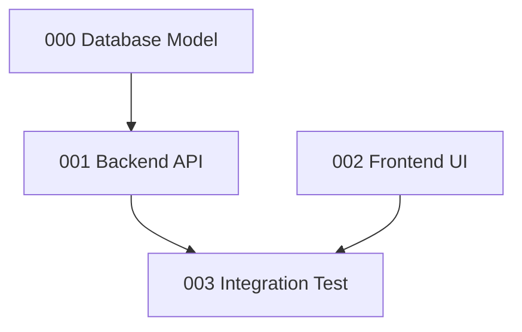

# Engineering Workflow Guide

本指南说明 Codex 如何组织软件开发任务、调度多个 Agent、管理 Git 工作区、执行 PR 审查、处理 CI 失败，以及完成最终交付。

本指南是全局 AGENTS.md 的执行参考，不重复定义全局授权边界和强制工程原则。

---

# 1. Workflow Overview

根据实际任务选择合适的开发流程。

## 1.1 Direct Execution

适用于简单修改：

1. 理解需求。
2. 检查相关代码。
3. 实施修改。
4. 执行适当验证。
5. 汇报结果。

## 1.2 Planned Execution

适用于涉及多个文件或相关模块的任务：

1. 分析需求。
2. 检查项目架构。
3. 制定实施计划。
4. 更新 docs/task.md。
5. 执行开发。
6. 运行测试。
7. 检查修改结果。
8. 完成交付。

## 1.3 Full Engineering Workflow

适用于复杂功能、跨模块开发和重大工程变更：

1. Requirement Analysis
2. Technical Investigation
3. Architecture Design
4. Task Planning
5. Agent Scheduling
6. Implementation
7. Local Verification
8. Pull Request
9. Continuous Integration
10. Independent Review
11. Integration & Acceptance
12. User Authorization
13. Final Delivery

这些流程可以根据实际情况组合，不要求机械执行所有步骤。

---

# 2. Task Planning & Dependency Analysis

## 2.1 Main Agent Planning

主 Agent 负责制定正式开发计划。

规划时应考虑：

- 每个任务是否具有独立开发目标。
- 是否具有明确交付结果。
- 是否存在前置依赖。
- 是否可以并行执行。
- 是否可能产生文件冲突。
- 是否需要独立 PR。
- 是否需要独立 Reviewer。

不要按照函数、文件或代码行数机械拆分任务。

## 2.2 Formal Task Management

正式任务统一记录在：

`docs/task.md`

任务编号：

`YYYYMMDD-HHmm-NNN`

例如：

```text
20261123-1430-000
20261123-1430-001
20261123-1615-000
```

同一项目由主 Agent 统一分配正式任务编号。

同一批次从 000 开始递增。不同批次可以重新编号。

正式任务字段：

- Task ID
- Description
- Status
- Priority
- Requirements
- Dependencies

任务状态：

- READY
- WORKING
- WAITING
- FINISH

优先级：

- HIGH
- MEDIUM
- LOW

主 Agent 是 docs/task.md 的唯一维护者。

Worker 的内部子任务不需要进入正式任务清单。

## 2.3 Dependency Graph

主 Agent 根据 task.md 中的 Dependencies 建立内部任务依赖关系。

Example:



判断原则：

- 没有依赖关系的任务可以并行。
- 存在前置依赖的任务必须等待。
- 公共接口未确定时，不应让依赖它的 Worker 自行假设接口。
- 一个任务失败时，只暂停受影响的任务。
- 恢复 WAITING 任务之前，重新验证阻塞条件。

依赖图由主 Agent 根据 task.md 自动分析，不需要维护第二份任务数据。

---

# 3. Multi-Agent Scheduling

## 3.1 Agent Roles

### Main Agent

负责：

- 用户沟通。
- 需求理解。
- 正式任务规划。
- Worker 调度。
- 接口协调。
- 异常处理。
- PR 集成。
- 最终验收。

### Worker

负责：

- 执行分配的任务。
- 修改代码。
- 编写必要测试。
- 执行本地验证。
- 提交 Commit。
- 根据安排创建 PR。
- 返回实际执行结果。

### Reviewer

负责：

- 独立检查代码修改。
- 检查需求符合性。
- 检查架构约束。
- 检查潜在逻辑和安全问题。
- 提供审查意见。

Reviewer 不直接修改原 PR 的实现代码。

## 3.2 When to Use Workers

主 Agent 根据任务独立性和并行收益决定是否调用 Worker。

适合并行的情况：

- 多个模块可以独立实现。
- 接口已经确定。
- 修改范围相对独立。
- 可以分别验证交付结果。

不适合并行的情况：

- 多个任务必须严格顺序执行。
- 核心接口尚未确定。
- 多个 Worker 必须频繁修改相同文件。
- 协调成本明显高于并行收益。

默认最多三个并发 Worker。

不要为了使用全部 Worker 名额而强行拆分任务。

## 3.3 Worker Task Contract

主 Agent 分配任务时，应提供明确的任务契约。

推荐包含：

```markdown
# Worker Assignment

## Objective
需要完成什么？

## Context
相关需求、架构和现有实现。

## Scope
允许修改的模块和文件范围。

## Constraints
接口、技术栈及其他开发约束。

## Acceptance
完成任务需要满足什么条件？

## Deliverables
需要提交什么代码、测试和结果？
```

任务契约通过 Agent 间消息传递即可，不要求每次生成独立 Markdown。

## 3.4 Worker Communication

Worker 应在以下重要节点反馈：

- 开始执行。
- 发现阻塞。
- 发现接口或架构冲突。
- 发现超出授权范围的问题。
- 完成实现。
- 提交 PR。

不要求固定时间间隔汇报。

主 Agent 应根据反馈及时协调任务和依赖。

## 3.5 Worker Completion Report

Worker 完成任务后，返回：

```markdown
# Task Result

## Status
IMPLEMENTATION_COMPLETED / BLOCKED / FAILED

## Implementation Summary
完成了什么？

## Modified Files
修改了哪些文件？

## Design Decisions
有哪些重要实现决定？

## Tests
执行了哪些测试？

## Test Results
测试是否通过？

## Commit
Commit Hash

## Pull Request
PR URL（如适用）

## Remaining Issues
尚未解决的问题。
```

Worker 必须报告实际执行结果。

不能仅凭 Worker 表示完成，就认为正式任务已经完成。

## 3.6 Worker Lifecycle

主 Agent 根据任务关联性管理 Worker 生命周期。

复用条件：

- 新任务与原任务领域相近。
- 原任务已经完成交付。
- 原有上下文仍然有效。
- 新任务范围能够重新明确。

结束条件：

- 没有相关后续任务。
- 技术领域发生变化。
- 上下文已经混杂或过时。
- Worker 无法可靠继续执行。

更换 Worker 时，必须交接已有实现、Commit、测试结果和未解决问题。

Reviewer 完成审查后，默认结束执行。

实际创建、复用和结束操作取决于当前 Codex 环境支持的能力。

---

# 4. Git Branch & Worktree Management

## 4.1 Branch Strategy

推荐使用以下分支类型：

| Prefix | Purpose |
|---|---|
| feature/ | 新功能 |
| fix/ | Bug 修复 |
| refactor/ | 代码重构 |
| docs/ | 文档修改 |
| test/ | 测试相关修改 |

分支名称可以包含完整任务编号。

Example:

```text
feature/20261123-1430-000-user-auth
fix/20261123-1615-000-login-error
refactor/20261124-0900-000-resource-layer
```

具体分支命名可以根据项目现有约定调整。

## 4.2 Worktree Strategy

多 Agent 并行开发时，优先为每个 Worker 建立独立 Worktree。

Example:

```text
Project/
├── main-workspace/
│
├── .worktrees/
│   ├── worker-a/
│   ├── worker-b/
│   └── worker-c/
│
└── .git/
```

每个 Worker 使用独立工作目录和 Git 分支。

注意：

- Worktree 隔离工作目录，不代表隔离所有外部资源。
- 多个 Worktree 共享 Git 仓库对象数据库。
- 不同 Worker 仍然可能修改同一个文件。
- 数据库、端口和外部测试环境需要额外协调。

## 4.3 Worktree Operations

创建 Worktree：

```bash
git worktree add -b feature/example ../worker-example main
```

查看 Worktree：

```bash
git worktree list
```

检查工作区：

```bash
git status
```

移除 Worktree：

```bash
git worktree remove ../worker-example
```

删除已确认不再需要的本地分支：

```bash
git branch -d feature/example
```

执行清理前：

1. 检查工作区状态。
2. 确认重要修改已经提交或安全保存。
3. 确认代码已经合并或明确放弃。
4. 确认没有其他 Worker 继续使用。
5. 再执行清理。

不要使用强制删除操作掩盖未解决的修改。

## 4.4 File Ownership

主 Agent 应尽可能明确各 Worker 的主要修改范围。

如果多个 Worker 必须修改同一文件：

- 提前协调。
- 明确修改边界。
- 确认接口。
- 确认集成顺序。
- 集成时重新检查冲突。

---

# 5. Commit Management

## 5.1 Conventional Commits

所有项目统一使用 Conventional Commits。

格式：

```text
<type>(<scope>): <description>
```

常用类型：

- feat
- fix
- refactor
- test
- docs
- build
- ci
- chore

Examples:

```text
feat(auth): implement user login

fix(media): handle invalid video paths

refactor(database): simplify query layer

test(auth): add login integration tests

docs(architecture): update module dependencies
```

scope 根据实际业务模块确定。

## 5.2 Commit Rules

- 每个 Commit 应具有清晰目的。
- 不混入无关修改。
- 不提交密钥、敏感数据和本地临时文件。
- 不随意修改其他 Worker 的提交。
- 应根据修改内容合理拆分 Commit。

Worker 可以自主 Commit 和 Push，不需要每次向用户申请。

---

# 6. Pull Request Management

## 6.1 PR Strategy Selection

主 Agent 根据任务依赖、模块耦合程度和审查成本选择 PR 方式。

### Independent PR

适用于：

- 模块独立。
- 接口明确。
- 修改范围清晰。
- 可以单独审查。

Worker 分别提交 PR。

### Consolidated PR

适用于：

- 多个 Worker 修改高度耦合的功能。
- 多个修改必须共同验证。
- 分别提交 PR 会产生较高协调成本。

主 Agent 收集 Worker 的交付结果，在集成分支上完成整合，再创建功能级 PR。

两种方式均可使用。

主 Agent 保留最终判断权。

## 6.2 PR Description

PR 应提供足够的信息供用户和 Reviewer 理解。

推荐结构：

```markdown
## Related Work

- Task:
- Requirements:

## Summary

完成了什么？

## Implementation

采用了什么实现方式？

## Changes

修改了哪些重要文件和模块？

## Verification

- [ ] Static Analysis
- [ ] Automated Tests
- [ ] Build

Test Results:

## Risks & Limitations

潜在风险和遗留问题。

## Review Notes

需要 Reviewer 特别关注的内容。
```

不要求所有任务都填写全部字段。

## 6.3 PR Review

根据变更影响范围决定是否调用独立 Reviewer。

重要功能、核心架构修改和高风险变更必须进行独立审查。

普通低风险修改可以由主 Agent 直接审查。

Reviewer 应：

- 检查需求符合性。
- 检查架构符合性。
- 检查实现逻辑。
- 检查测试证据。
- 识别安全与集成风险。
- 提供可定位的问题和修复建议。

## 6.4 PR Review Results

统一使用：

- APPROVED
- CHANGES_REQUESTED
- ESCALATE

处理方式：

- APPROVED：进入主 Agent 集成验收。
- CHANGES_REQUESTED：返回原 Worker 修复原 PR。
- ESCALATE：由主 Agent 分析并处理。

Reviewer 不直接修改原 PR 的代码。

## 6.5 Merge Authorization

PR 合并前必须：

1. 完成必要 CI 检查。
2. 完成必要 Reviewer 审查。
3. 检查依赖 PR 的合并顺序。
4. 主 Agent 完成集成验证。
5. 向用户提供变更摘要和风险信息。
6. 等待用户授权。

主 Agent 不得擅自合并 PR。

---

# 7. Continuous Integration

## 7.1 CI Requirements

中大型项目必须建立基础 CI。

根据技术栈执行适用的：

- Dependency Installation.
- Format Check.
- Static Analysis.
- Automated Tests.
- Build Verification.

小型项目可以使用更简单的验证方式。

不要为了建立 CI 而引入不必要的复杂配置。

## 7.2 GitHub Actions

GitHub Actions 可以用于：

- Push 检查。
- Pull Request 检查。
- 自动化测试。
- 构建验证。
- 安全扫描。
- Release 自动化。

项目应根据实际需要组织 Workflow。

小型项目可以从一个 ci.yml 开始。

不要求所有项目初始化时都建立多个空 Workflow。

## 7.3 CI Trigger

推荐配置：

| Event | Behavior |
|---|---|
| Push | 根据项目配置执行检查 |
| Pull Request | 执行适用的基础检查 |
| PR Update | 重新执行相关检查 |
| Merge to main | 执行主分支验证 |
| Scheduled | 按需执行定期检查 |

中大型项目的 PR 创建和更新必须触发适用的基础 CI。

## 7.4 CI Failure Recovery

CI 失败后：

1. 获取实际失败日志。
2. 判断异常类型。
3. 分析失败原因。
4. 原 Worker 优先修复。
5. 本地重新执行相关验证。
6. Push 更新原 PR。
7. 重新运行 CI。

默认连续两轮有效修复失败后，停止重复尝试并交由主 Agent 重新分析。

不得：

- 删除有效测试。
- 降低有效测试断言。
- 隐藏失败。
- 随意跳过 Required Checks。
- 未经授权修改 CI 权限。

## 7.5 Repository Protection

中大型 GitHub 项目应配置 main 分支保护。

推荐启用：

- Required Status Checks.
- Required Reviews when appropriate.
- Restricted Direct Pushes.
- Least-Privilege Workflow Permissions.

小型项目根据实际需要配置。

修改仓库保护设置必须获得用户授权。

---

# 8. Failure Handling & Recovery

## 8.1 Failure Categories

将重要异常分类为：

- ENVIRONMENT
- IMPLEMENTATION
- TEST
- INTEGRATION
- ARCHITECTURE
- SECURITY / DATA

先分析原因，再选择处理方式。

## 8.2 Local Failure Isolation

一个 Worker 失败，不应无条件停止其他 Worker。

例如：

```text
Worker A: Database
    |
    +--> Worker B: Backend API

Worker C: Frontend UI
```

如果 Worker A 失败：

- Worker A 暂停处理。
- Worker B 进入 WAITING。
- Worker C 在不受影响的情况下继续。

如果失败涉及共享资源或安全风险，主 Agent 可以扩大暂停范围。

## 8.3 Recovery Strategy

普通实现和测试问题：

- 原 Worker 优先修复。
- 默认最多两轮有效自动修复。

简单环境问题：

- 可以自主检查和修复。
- 根据风险合理重试。

架构问题：

- 主 Agent 重新分析。
- 涉及重大决策时询问用户。

安全和数据风险：

- 立即暂停受影响操作。
- 保留证据。
- 通知用户。

Reviewer 提出的修改意见不机械套用普通两轮限制，但不能无限重复修复。

## 8.4 Worker Replacement

更换 Worker 时，必须交接：

- 原始任务目标。
- 已完成的工作。
- 当前分支和 Commit。
- 修改过的文件。
- 测试结果。
- 未解决问题。
- 当前 Worktree 状态。

不得覆盖尚未确认的修改。

## 8.5 Worktree Cleanup

清理前：

- 检查 Git 状态。
- 确认重要修改已经保存。
- 确认分支是否合并。
- 确认没有其他 Worker 正在使用。
- 保留必要的日志和证据。

删除 Worktree 不代表可以随意删除对应分支。

---

# 9. Final Integration & Delivery

## 9.1 Main Agent Integration

多个 Worker 完成后，主 Agent 必须检查：

- 模块接口是否一致。
- 依赖是否满足。
- 是否存在重复实现。
- 是否存在接口不兼容。
- 是否通过必要集成测试。
- 是否满足 requirements.md。
- 是否需要更新 architecture.md。

单独 PR 通过审查不代表整体集成已经完成。

## 9.2 Task Acceptance

正式任务满足以下条件后，才可以标记 FINISH：

- 实际实现符合任务目标。
- 关联需求得到满足。
- 必要测试通过。
- 必要审查完成。
- 相关代码已经按计划集成。
- 必要文档已经更新。
- 主 Agent 完成验收。

如果代码已验收但仍在等待用户批准合并，任务保持 WAITING。

完成验收后：

1. 必要时生成开发报告。
2. 保存有价值的测试证据。
3. 从 docs/task.md 移除已完成任务。
4. 检查下游任务。
5. 恢复满足条件的 READY 任务。

## 9.3 Development Report

重要开发工作可以在以下目录保存报告：

```text
dev/
└── records/
    └── YYYYMMDD-HHmm-NNN-task-name/
        ├── report.md
        └── evidence/
```

重要报告可提交 Git。

大型测试产物默认放入 artifacts/，不直接提交。

普通 Bug 修复和简单 UI 修改通常不需要独立报告。

## 9.4 Final Delivery Summary

根据任务规模提供适当的交付摘要。

建议包含：

- Completed
- Changes
- Implementation
- Verification
- Review
- PR
- Remaining Issues

必须区分：

- 代码实现完成。
- 主 Agent 验收完成。
- PR 已经合并。
- 正式 Release 已经发布。
- 生产环境已经部署。

不得将尚未完成的阶段报告为成功。

---

# 10. Workflow Execution Principles

- Follow the global AGENTS.md authorization boundaries.
- Follow project-specific instructions.
- Prefer practical workflows over unnecessary procedures.
- Preserve task and dependency consistency.
- Keep Worker responsibilities clear.
- Verify actual implementation and test results.
- Escalate decisions that exceed current authorization.
- Preserve valuable engineering history.

The main Agent remains responsible for coordinating the complete development workflow and delivering reliable results to the user.