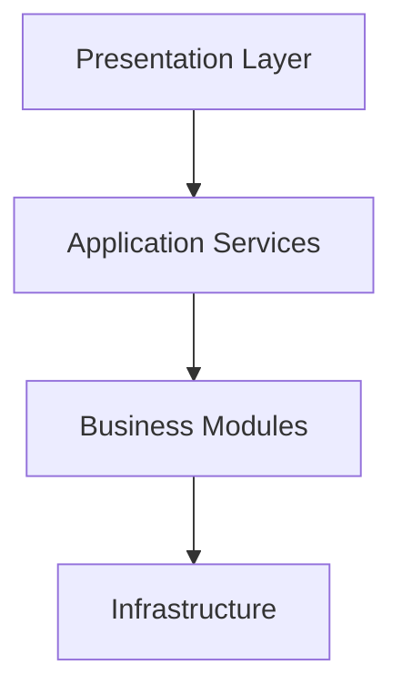
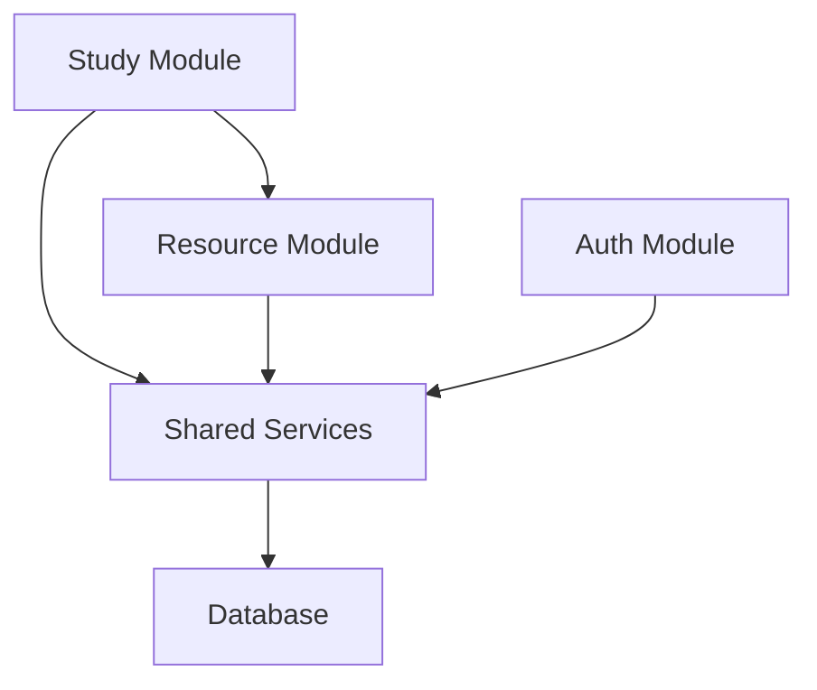
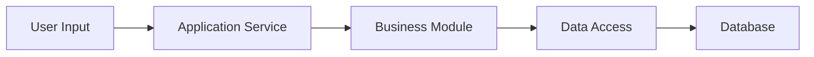

# Architecture

本文档描述项目当前实际实施的系统架构，包括模块职责、模块依赖、重要接口、数据流和关键技术方案。

本文档必须与实际代码和配置保持一致。

尚未实施的架构方案不得描述为当前实际架构。

---

# 1. System Overview

## 1.1 Architecture Summary

简要说明系统整体架构、主要组成部分及其协作方式。

## 1.2 Technology Stack

| Component | Technology | Purpose |
|---|---|---|
| Application | [Technology] | [Purpose] |
| Backend | [Technology] | [Purpose] |
| Database | [Technology] | [Purpose] |
| Communication | [Technology] | [Purpose] |

只记录实际使用的核心技术。

具体版本和开发环境信息由项目根目录 AGENTS.md 管理。

## 1.3 System Architecture Diagram

根据项目复杂度提供系统整体架构图。

Example:

图表应反映实际模块关系，不得将尚未实现的组件绘制成现有系统的一部分。

---

# 2. Module Architecture

按照业务职责记录系统主要模块。

不要求所有项目使用相同的模块名称或目录结构。

## MOD-001 - [Module Name]

**Responsibilities:**

- [Responsibility 1]
- [Responsibility 2]

**Boundary:**

说明模块负责什么，以及明确不负责什么。

**Dependencies:**

- [Module A]
- [Module B]

**Public Interfaces:**

- [Interface 1]
- [Interface 2]

**Data Ownership:**

说明该模块负责管理的数据，以及其他模块访问这些数据的方式。

---

## MOD-002 - [Module Name]

**Responsibilities:**

- [Responsibility 1]
- [Responsibility 2]

**Boundary:**

[Module boundary description]

**Dependencies:**

- [Module A]

**Public Interfaces:**

- [Interface 1]

**Data Ownership:**

[Data ownership description]

---

# 3. Module Dependencies & Interaction

## 3.1 Dependency Diagram

使用 Mermaid 或 UML 表示重要模块之间的依赖关系。

Example:

根据实际架构调整图表。

## 3.2 Interaction Rules

说明模块之间如何协作。

可以记录：

- 接口调用关系。
- 事件通知机制。
- 数据访问方式。
- 重要业务流程。
- 跨模块协调方式。

模块可以根据业务需求进行双向协作，但必须使用明确的接口或约定机制。

避免未经设计的循环依赖和直接访问其他模块的内部实现。

## 3.3 Dependency Constraints

记录重要的架构约束。

例如：

- 业务模块不得直接访问其他业务模块的内部数据库实现。
- 跨模块数据访问必须遵循公开接口。
- 公共模块不得依赖具体业务模块的内部实现。
- 模块之间不得形成未经设计的循环依赖。

只记录当前项目真正需要的约束。

---

# 4. Shared Components

记录被多个业务模块共同使用的基础能力。

## SHARED-001 - [Component Name]

**Responsibilities:**

- [Shared responsibility]

**Consumers:**

- [Module A]
- [Module B]

**Public Interfaces:**

- [Interface 1]

**Boundary:**

说明该公共组件允许负责的能力，以及不应该包含的业务逻辑。

Example shared components:

- Logging
- Configuration
- Database Infrastructure
- File System Access
- Error Handling
- Common Infrastructure Services

不要将暂时无法归类的业务代码随意放入公共模块。

---

# 5. Important Interfaces

只记录具有跨模块价值或重要外部交互意义的接口。

不要求复制所有类、函数和方法签名。

## IF-001 - [Interface Name]

**Provider:**

[Providing module]

**Consumers:**

[Consuming modules]

**Purpose:**

说明接口负责解决什么问题。

**Input:**

[Important input data]

**Output:**

[Important output data]

**Constraints:**

说明重要的调用约束、异常行为或兼容性要求。

---

# 6. Data Architecture

根据项目需要描述核心数据结构和数据流。

## 6.1 Data Ownership

| Data Entity | Owner Module | Access Method |
|---|---|---|
| [Entity A] | [Module A] | [Interface] |
| [Entity B] | [Module B] | [Interface] |

## 6.2 Data Flow

说明重要业务数据在不同模块之间如何传递。

Example:

只描述当前实际存在的数据流。

---

# 7. External Dependencies & Integration

记录影响整体架构的重要外部系统和服务。

| Dependency | Purpose | Integration Method |
|---|---|---|
| [External Service] | [Purpose] | [API / SDK / Protocol] |
| [External Database] | [Purpose] | [Driver / Connection] |

可以记录：

- 外部 API。
- 第三方服务。
- 数据库系统。
- 消息队列。
- 网络通信协议。
- 外部 SDK。

不需要在这里重复列出所有普通开发依赖。

---

# 8. Important Technical Constraints

记录当前架构必须遵循的关键技术约束。

例如：

- 平台兼容性限制。
- 数据一致性要求。
- 网络通信限制。
- 资源生命周期管理。
- 关键性能约束。
- 公共接口兼容性要求。

只记录影响系统架构和模块协作的重要约束。

---

# 9. Architecture Maintenance

本文档维护规则：

1. 新增或删除重要业务模块时更新模块架构。
2. 修改模块职责时更新对应描述。
3. 修改重要模块依赖时更新依赖关系。
4. 修改重要公共接口时更新接口说明。
5. 修改核心数据所有权或数据流时更新数据架构。
6. 实际架构图发生变化时同步更新对应图表。
7. 删除不再实际存在的架构内容。
8. 不记录尚未实施的设计方案为当前架构。

重要架构决策及其历史演进由 `docs/adr/` 记录。

普通内部实现调整不需要无意义地修改整个架构文档。

---

# 10. Documentation Constraints

- 本文档描述实际实施的系统架构。
- 不重复 requirements.md 中的功能需求。
- 不记录 task.md 中的开发进度。
- 不记录完整源代码目录和每个文件的职责。
- 不复制所有类和函数的完整定义。
- 不重复项目根目录 AGENTS.md 中的环境配置。
- 不记录尚未确认或尚未实施的架构方案。
- 不代替 ADR 记录重要架构决策过程。